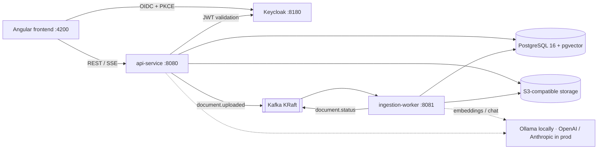

# DocQuery: AI Document Intelligence Platform

> Retrieval-augmented generation (RAG) platform built with Spring AI, Kafka, pgvector and Angular: multi-tenant, observable, and deployable to Kubernetes.

[](.github/workflows/ci.yml)

**Status: Phase 1 (Foundation) complete.** The monorepo, local infrastructure, health checks and baseline CI are in place. Features land phase by phase (see [Roadmap](#roadmap)).

## Architecture



| Module | What it is |
|--------|------------|
| [`api-service/`](api-service) | Spring Boot 4.1: auth, workspaces, documents, search, RAG chat |
| [`ingestion-worker/`](ingestion-worker) | Spring Boot 4.1: Kafka consumer running extract → chunk → embed → index |
| [`frontend/`](frontend) | Angular 22 (standalone, signals, zoneless) + Tailwind CSS 4 |
| [`infra/`](infra) | Config for the Compose stack: Postgres init, Keycloak realm, object storage |
| [`docs/`](docs) | Architecture Decision Records ([`docs/adr`](docs/adr)) |

## Run locally

Prerequisites: Docker Desktop (with Compose v2), Java 21, Node 24+.

```bash
docker compose up -d --wait                       # Postgres+pgvector, Kafka, object storage, Keycloak
docker compose --profile ai up -d                 # optional: Ollama + model download (~2.5 GB)
docker compose --profile apps up -d --build --wait  # optional: run both Spring services in containers
```

Or run the services from source against the Compose infrastructure:

```bash
cd api-service && ./mvnw spring-boot:run           # http://localhost:8080/actuator/health
cd ingestion-worker && ./mvnw spring-boot:run      # http://localhost:8081/actuator/health
cd frontend && npm install && npm start            # http://localhost:4200
```

All settings have safe local defaults. To override them, copy `.env.example` to `.env`.

| Service | URL | Credentials (local only) |
|---------|-----|--------------------------|
| Keycloak admin | http://localhost:8180 | `admin` / `admin_local` |
| Demo users (realm `docquery`) | — | `owner`, `member`, `viewer` / `demo123` |
| Postgres | `localhost:5432` | `docquery` / `docquery_local` |
| Kafka | `localhost:9092` | — |
| S3 API (SeaweedFS) | http://localhost:8333 | `docquery` / `docquery_local_secret` |
| Ollama (profile `ai`) | http://localhost:11434 | — |

## Tests

```bash
cd api-service && ./mvnw verify        # Testcontainers: pgvector Postgres
cd ingestion-worker && ./mvnw verify   # Testcontainers: Kafka (KRaft)
cd frontend && npm run test:ci         # Vitest
```

## Key decisions so far

- [ADR 0001](docs/adr/0001-platform-versions.md): **Spring Boot 4.1.2 + Spring AI 2.0.1**, the latest GA pairing that Spring officially marks as compatible.
- [ADR 0002](docs/adr/0002-s3-compatible-object-storage.md): **SeaweedFS instead of MinIO.** MinIO's community edition was archived and no longer ships images. The app speaks plain S3, so any S3 provider works.

## Roadmap

1. ✅ Foundation
2. Auth & workspaces
3. Documents
4. Ingestion pipeline
5. RAG chat
6. Usage & admin
7. Observability
8. Testing & evaluation
9. Kubernetes & deployment
10. Docs

---

Built with AI-assisted development (Claude Code); all code reviewed and tested by me.
