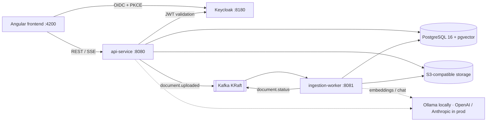

# DocQuery: AI Document Intelligence Platform

> Retrieval-augmented generation (RAG) platform built with Spring AI, Kafka, pgvector and Angular: multi-tenant, observable, and deployable to Kubernetes.

[](.github/workflows/ci.yml)

**Status: Phase 2 (Auth & workspaces) complete.** Keycloak login (OIDC + PKCE), multi-workspace membership with OWNER / MEMBER / VIEWER roles, tenant-isolation tests and an Angular workspace switcher are in place. Features land phase by phase (see [Roadmap](#roadmap)).

## Architecture



| Module | What it is |
|--------|------------|
| [`api-service/`](api-service) | Spring Boot 4.1: auth, workspaces, documents, search, RAG chat |
| [`ingestion-worker/`](ingestion-worker) | Spring Boot 4.1: Kafka consumer running extract → chunk → embed → index |
| [`frontend/`](frontend) | Angular 22 (standalone, signals, zoneless) + Tailwind CSS 4 |
| [`infra/`](infra) | Config for the Compose stack: Postgres init, Keycloak realm, object storage |
| [`docs/`](docs) | Architecture Decision Records ([`docs/adr`](docs/adr)) |

## Run locally

Prerequisites: Docker Desktop (with Compose v2), Java 21, Node 24+.

```bash
docker compose up -d --wait                       # Postgres+pgvector, Kafka, object storage, Keycloak
docker compose --profile ai up -d                 # optional: Ollama + model download (~2.5 GB)
docker compose --profile apps up -d --build --wait  # optional: run both Spring services in containers
```

Or run the services from source against the Compose infrastructure:

```bash
cd api-service && ./mvnw spring-boot:run           # http://localhost:8080/actuator/health
cd ingestion-worker && ./mvnw spring-boot:run      # http://localhost:8081/actuator/health
cd frontend && npm install && npm start            # http://localhost:4200
```

All settings have safe local defaults. To override them, copy `.env.example` to `.env`.
Docker Compose and the api-service (when run from source) both read that file.

> **Already have PostgreSQL installed locally?** A native install listening on 5432 wins over
> Docker for `localhost:5432` connections, and the API then fails with
> `password authentication failed for user "docquery"`. Put a free port in `.env`:
>
> ```bash
> echo POSTGRES_PORT=55432 >> .env
> docker compose up -d --wait
> ```
>
> Compose publishes Postgres on that port and `./mvnw spring-boot:run` connects to it.
> The `apps` profile containers are unaffected (they use the Docker network).

| Service | URL | Credentials (local only) |
|---------|-----|--------------------------|
| Keycloak admin | http://localhost:8180 | `admin` / `admin_local` |
| Demo users (realm `docquery`) | http://localhost:4200 | `owner`, `member`, `viewer`, `outsider` / `demo123` |
| Postgres | `localhost:5432` (or `POSTGRES_PORT`) | `docquery` / `docquery_local` |
| Kafka | `localhost:9092` | — |
| S3 API (SeaweedFS) | http://localhost:8333 | `docquery` / `docquery_local_secret` |
| Ollama (profile `ai`) | http://localhost:11434 | — |

## Auth & workspaces

Sign in at http://localhost:4200 with a demo account. All demo users except `outsider` are members of
**Demo workspace**:

| User | Role in Demo workspace | Can |
|------|------------------------|-----|
| `owner` | OWNER | rename/delete the workspace, add/remove members, change roles |
| `member` | MEMBER | read; upload and ask questions (later phases) |
| `viewer` | VIEWER | read and ask questions (later phases) |
| `outsider` | none | shows tenant isolation: sees only their own workspaces |

Anyone can create a workspace and becomes its owner. Members are added by username or e-mail once they
have signed in at least once.

API (all under `/api`, bearer token required, errors are RFC 9457 `application/problem+json`):

| Method | Path | Minimum role |
|--------|------|--------------|
| GET | `/me` | signed in |
| GET, POST | `/workspaces` | signed in |
| GET | `/workspaces/{id}` | VIEWER |
| PATCH, DELETE | `/workspaces/{id}` | OWNER |
| GET | `/workspaces/{id}/members` | VIEWER |
| POST | `/workspaces/{id}/members` | OWNER |
| PUT | `/workspaces/{id}/members/{userId}` | OWNER |
| DELETE | `/workspaces/{id}/members/{userId}` | OWNER, or yourself (leave) |

Non-members always get `404`, never `403`, so workspace ids cannot be probed. See
[ADR 0003](docs/adr/0003-keycloak-for-identity.md) and [ADR 0004](docs/adr/0004-workspace-authorization-and-tenant-isolation.md).

Get a token from the command line (local dev client only, never in production):

```bash
TOKEN=$(curl -s -d grant_type=password -d client_id=docquery-dev-cli -d username=owner -d password=demo123   http://localhost:8180/realms/docquery/protocol/openid-connect/token | jq -r .access_token)
curl -s -H "Authorization: Bearer $TOKEN" http://localhost:8080/api/me | jq
```

## Tests

```bash
cd api-service && ./mvnw verify        # Testcontainers: pgvector Postgres + real Keycloak with the committed realm
cd ingestion-worker && ./mvnw verify   # Testcontainers: Kafka (KRaft)
cd frontend && npm run test:ci         # Vitest
```

## Key decisions so far

- [ADR 0001](docs/adr/0001-platform-versions.md): **Spring Boot 4.1.2 + Spring AI 2.0.1**, the latest GA pairing that Spring officially marks as compatible.
- [ADR 0002](docs/adr/0002-s3-compatible-object-storage.md): **SeaweedFS instead of MinIO.** MinIO's community edition was archived and no longer ships images. The app speaks plain S3, so any S3 provider works.
- [ADR 0003](docs/adr/0003-keycloak-for-identity.md): **Keycloak + OIDC code flow with PKCE**; the API is a stateless resource server that checks signature, issuer and audience.
- [ADR 0004](docs/adr/0004-workspace-authorization-and-tenant-isolation.md): **Workspace roles live in Postgres**; every query is scoped by workspace; non-members get 404; a guard test covers every workspace endpoint.

## Roadmap

1. ✅ Foundation
2. ✅ Auth & workspaces
3. Documents
4. Ingestion pipeline
5. RAG chat
6. Usage & admin
7. Observability
8. Testing & evaluation
9. Kubernetes & deployment
10. Docs

---

Built with AI-assisted development (Claude Code); all code reviewed and tested by me.
