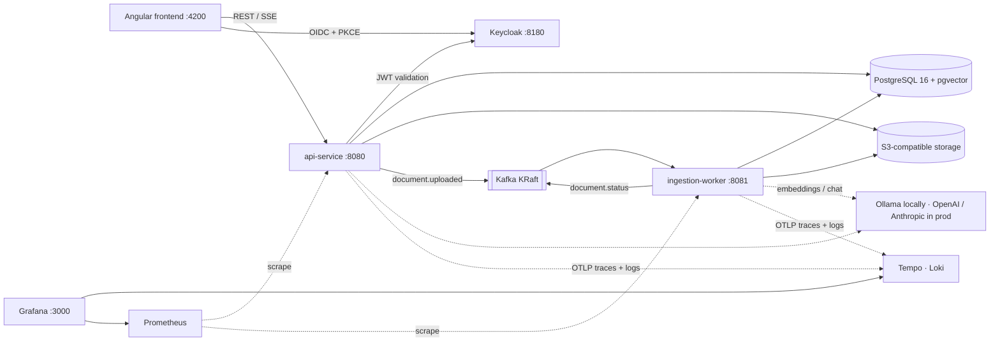
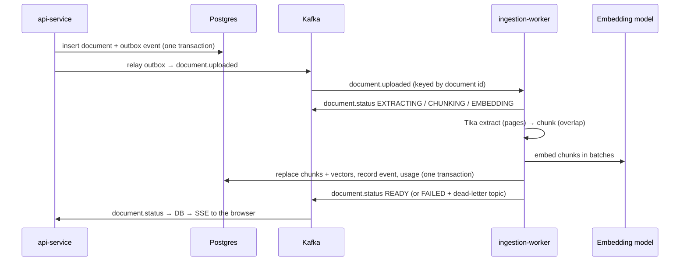
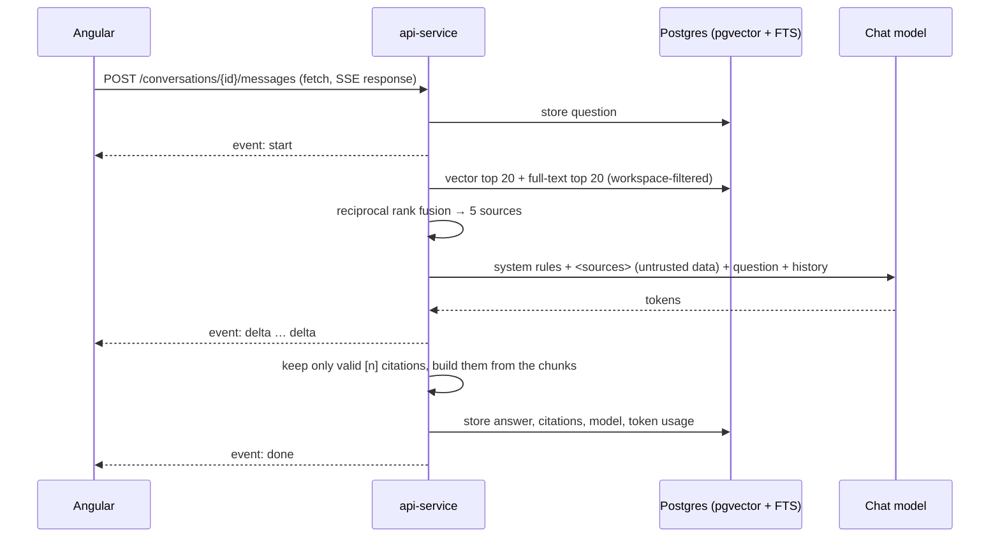

# DocQuery: AI Document Intelligence Platform

> Retrieval-augmented generation (RAG) platform built with Spring AI, Kafka, pgvector and Angular: multi-tenant, observable, and deployable to Kubernetes.

[](.github/workflows/ci.yml)

**Status: Phase 6 (Usage & admin) complete.** Keycloak login (OIDC + PKCE), multi-workspace roles with tenant-isolation tests, a document library with content-validated uploads and live status (SSE), an event-driven ingestion pipeline (Kafka outbox, idempotent worker, retries, dead-letter topic → Tika → chunks → embeddings → pgvector), and **grounded chat**: hybrid retrieval (pgvector + full-text search, reciprocal rank fusion), answers streamed word by word with citations to document and page, a citation viewer, and prompt-injection hygiene with tests. **Usage & cost safety**: token and estimated-cost tracking per workspace and user, daily question/upload quotas, a per-user workspace-creation limit, and an admin page with usage charts, pipeline failures and dead-letter retry. Features land phase by phase (see [Roadmap](#roadmap)).

## Architecture



| Module | What it is |
|--------|------------|
| [`api-service/`](api-service) | Spring Boot 4.1: auth, workspaces, documents, search, RAG chat |
| [`ingestion-worker/`](ingestion-worker) | Spring Boot 4.1: Kafka consumer running extract → chunk → embed → index |
| [`frontend/`](frontend) | Angular 22 (standalone, signals, zoneless) + Tailwind CSS 4 |
| [`infra/`](infra) | Config for the Compose stack: Postgres init, Keycloak realm, object storage, observability (Prometheus, Tempo, Loki, Grafana dashboards) |
| [`docs/`](docs) | Architecture Decision Records ([`docs/adr`](docs/adr)) |

## Run locally

Prerequisites: Docker Desktop (with Compose v2), Java 21, Node 24+, and [Ollama](https://ollama.com)
installed natively (uses your GPU) with the embedding model pulled:

```bash
ollama pull nomic-embed-text   # embeddings (768 dimensions, ~270 MB), needed from Phase 4
ollama pull llama3.2:3b        # chat model (fits a 4 GB GPU); qwen2.5:7b answers better; OLLAMA_CHAT_MODEL picks it
```

```bash
docker compose up -d --wait                       # Postgres+pgvector, Kafka, object storage, Keycloak, observability
docker compose --profile apps up -d --build --wait  # optional: run both Spring services in containers
docker compose --profile ai up -d                 # optional fallback: Ollama in a container (set OLLAMA_BASE_URL=http://ollama:11434)
```

Or run the services from source against the Compose infrastructure:

```bash
cd api-service && ./mvnw spring-boot:run           # http://localhost:8080/actuator/health
cd ingestion-worker && ./mvnw spring-boot:run      # http://localhost:8081/actuator/health
cd frontend && npm install && npm start            # http://localhost:4200
```

All settings have safe local defaults. To override them, copy `.env.example` to `.env`.
Docker Compose and both Spring services (when run from source) read that file.

> **Already have PostgreSQL installed locally?** A native install listening on 5432 wins over
> Docker for `localhost:5432` connections, and the API then fails with
> `password authentication failed for user "docquery"`. Put a free port in `.env`:
>
> ```bash
> echo POSTGRES_PORT=55432 >> .env
> docker compose up -d --wait
> ```
>
> Compose publishes Postgres on that port and `./mvnw spring-boot:run` connects to it.
> The `apps` profile containers are unaffected (they use the Docker network).

| Service | URL | Credentials (local only) |
|---------|-----|--------------------------|
| Keycloak admin | http://localhost:8180 | `admin` / `admin_local` |
| Demo users (realm `docquery`) | http://localhost:4200 | `owner`, `member`, `viewer`, `outsider`, `admin` / `demo123` |
| Postgres | `localhost:5432` (or `POSTGRES_PORT`) | `docquery` / `docquery_local` |
| Kafka | `localhost:9092` | — |
| S3 API (SeaweedFS) | http://localhost:8333 | `docquery` / `docquery_local_secret` |
| Ollama (native) | http://localhost:11434 | — |

## Auth & workspaces

Sign in at http://localhost:4200 with a demo account. All demo users except `outsider` are members of
**Demo workspace**:

| User | Role in Demo workspace | Can |
|------|------------------------|-----|
| `owner` | OWNER | rename/delete the workspace, add/remove members, change roles |
| `member` | MEMBER | read; upload and delete documents; ask questions |
| `viewer` | VIEWER | read and open documents; ask questions |
| `outsider` | none | shows tenant isolation: sees only their own workspaces |
| `admin` | none | platform admin (realm role `docquery-admin`): the **Admin** page; not a member of any workspace |

Anyone can create a workspace and becomes its owner. Members are added by username or e-mail once they
have signed in at least once.

API (all under `/api`, bearer token required, errors are RFC 9457 `application/problem+json`):

| Method | Path | Minimum role |
|--------|------|--------------|
| GET | `/me` | signed in |
| GET, POST | `/workspaces` | signed in |
| GET | `/workspaces/{id}` | VIEWER |
| PATCH, DELETE | `/workspaces/{id}` | OWNER |
| GET | `/workspaces/{id}/members` | VIEWER |
| POST | `/workspaces/{id}/members` | OWNER |
| PUT | `/workspaces/{id}/members/{userId}` | OWNER |
| DELETE | `/workspaces/{id}/members/{userId}` | OWNER, or yourself (leave) |

Non-members always get `404`, never `403`, so workspace ids cannot be probed. See
[ADR 0003](docs/adr/0003-keycloak-for-identity.md) and [ADR 0004](docs/adr/0004-workspace-authorization-and-tenant-isolation.md).

## Documents

Open a workspace: its home page is the **document library**. Members and owners drag files in (or
browse); everyone sees the list with status, page and chunk counts, size and uploader, and can open a
document (PDF and text open in a new tab, Word files download). The **Live** dot shows the status
stream is connected; changes made in another tab or by another user appear without a refresh.

- Accepted: PDF, DOCX, TXT, Markdown, validated by **content** (a renamed `.exe` is rejected with 415).
- Max size `DOCUMENT_MAX_FILE_SIZE` (default 25 MB, 413 above it); the same file twice in one workspace is rejected with 409.
- Files are stored under random keys in the S3 bucket; deleting a document or workspace removes the files.
- Status model: `UPLOADED → EXTRACTING → CHUNKING → EMBEDDING → READY` or `FAILED` (with reason),
  driven by the ingestion pipeline below. Members can **Retry** a failed document, **Re-index** a ready one,
  and **Retry** a document still queued after `DOCUMENT_REQUEUE_AFTER` (default 10 min).
- Documents uploaded before the pipeline existed are queued automatically by migration V5 on upgrade
  ([ADR 0010](docs/adr/0010-backfill-and-stuck-document-safety-net.md)).

| Method | Path | Minimum role |
|--------|------|--------------|
| GET | `/documents/upload-policy` | signed in |
| GET | `/workspaces/{id}/documents` | VIEWER |
| POST | `/workspaces/{id}/documents` (multipart `file`) | MEMBER |
| GET | `/workspaces/{id}/documents/{docId}` | VIEWER |
| GET | `/workspaces/{id}/documents/{docId}/content` | VIEWER |
| POST | `/workspaces/{id}/documents/{docId}/reindex` (202 if ready, failed or queued too long; else 409) | MEMBER |
| DELETE | `/workspaces/{id}/documents/{docId}` | MEMBER |
| GET | `/workspaces/{id}/documents/events` (SSE) | VIEWER |

See [ADR 0005](docs/adr/0005-document-upload-and-live-status.md).

Get a token from the command line (local dev client only, never in production):

```bash
TOKEN=$(curl -s -d grant_type=password -d client_id=docquery-dev-cli -d username=owner -d password=demo123   http://localhost:8180/realms/docquery/protocol/openid-connect/token | jq -r .access_token)
curl -s -H "Authorization: Bearer $TOKEN" http://localhost:8080/api/me | jq
```

## Ingestion pipeline



- **Extraction**: Apache Tika 4 (PDFBox, POI). PDFs keep real page numbers; DOCX/TXT/MD are one
  unpaginated block. Password-protected, damaged and text-less (scanned) files fail with a readable
  reason, without retries.
- **Chunking**: per page, up to 1,200 characters (~300 tokens) with 200 characters of overlap, cut at
  paragraph / sentence / word boundaries; each chunk keeps document, page and character offsets.
- **Embeddings**: Spring AI `EmbeddingModel`, batched (32 per call). Ollama `nomic-embed-text` locally,
  OpenAI with `EMBEDDING_PROVIDER=openai`. Model name and dimension are stored with every chunk;
  token usage per run goes to `embedding_usage` (estimated when the provider reports none).
- **Reliability**: transactional outbox (an upload never loses its event), idempotent worker
  (duplicates re-announce their outcome, chunks are replaced, never appended), retries with
  exponential backoff for transient errors, then `FAILED` + `document.uploaded.dlt`.
- **Tenant isolation**: chunks carry `workspace_id` with a composite foreign key to their document.

**Changed the embedding model?** Point the worker at the new model, then queue every document that
was embedded with another one (the worker re-embeds them; old chunks stay searchable until replaced):

```bash
cd api-service && ./mvnw spring-boot:run "-Dspring-boot.run.arguments=--spring.main.web-application-type=none --docquery.reindex.run=true --docquery.reindex.embedding-model=nomic-embed-text"
```

Add `--docquery.reindex.all=true` to re-index every finished document. See ADRs
[0006](docs/adr/0006-two-backend-services.md), [0007](docs/adr/0007-kafka-ingestion-events.md),
[0008](docs/adr/0008-pgvector-chunk-storage.md), [0009](docs/adr/0009-model-provider-abstraction.md).

## RAG chat

Open a workspace and choose **Ask**. Questions are answered only from the workspace's documents.
The answer streams in word by word; `[n]` markers become chips, and clicking one opens the **citation
viewer**: document name, page, the exact passage the answer used, and a button that opens the PDF
**at that page**. If nothing relevant is found, the answer is "I couldn't find this in your
documents." (without calling the model). Conversations are private to each user; any member, including
viewers, can ask.



- **Hybrid retrieval** ([ADR 0011](docs/adr/0011-hybrid-retrieval-with-reciprocal-rank-fusion.md)):
  pgvector (HNSW, iterative scan) + PostgreSQL full-text search (`english` stemming, OR-ed terms),
  merged by reciprocal rank fusion; vector hits under `RETRIEVAL_MIN_SIMILARITY` (0.6) are ignored.
  Falls back to full-text only if the embedding provider is down.
- **Follow-ups and focused questions**: follow-up questions ("what about this CV?") are rewritten into a
  standalone search query from the conversation (stored with the answer as `search_query`). Questions
  about one document (summaries, assessments) get more of that document's passages. Source text is
  capped to fit the model's context.
- **Answers**: facts are cited, never attributed to a person or entity the passage doesn't name.
  Assessments are split into **Facts / Assessment / Missing information**. Answers are always in the
  question's language. A safe Markdown subset (lists, bold, code) is rendered without HTML.
- **Grounding and prompt-injection hygiene** ([ADR 0012](docs/adr/0012-grounded-answers-and-prompt-injection-hygiene.md)):
  rules only in the system message; document text inside delimited, neutralized `<source>` blocks;
  citations validated and built server-side; answers rendered as plain text; no tools.
- **Models**: `CHAT_PROVIDER=ollama` (default, `OLLAMA_CHAT_MODEL=llama3.2:3b`), `openai` or
  `anthropic` (API key in the environment). Model and token usage are stored with every answer.
- **Stop** cancels generation on the server; the partial answer is kept and marked as failed.

| Method | Path | Minimum role |
|--------|------|--------------|
| GET | `/workspaces/{id}/search?q=…&limit=10` (retrieval only, with vector/keyword ranks) | VIEWER |
| GET, POST | `/workspaces/{id}/conversations` (your own) | VIEWER |
| GET, DELETE | `/workspaces/{id}/conversations/{conversationId}` (your own) | VIEWER |
| POST | `/workspaces/{id}/conversations/{conversationId}/messages` `{"question": "…"}` → SSE | VIEWER |

```bash
W=00000000-0000-4000-8000-000000000001   # Demo workspace
C=$(curl -s -X POST -H "Authorization: Bearer $TOKEN" http://localhost:8080/api/workspaces/$W/conversations | jq -r .id)
curl -N -X POST -H "Authorization: Bearer $TOKEN" -H "Content-Type: application/json"   -d '{"question":"How many vacation days do employees get?"}'   http://localhost:8080/api/workspaces/$W/conversations/$C/messages
```

> **Small local model, honest caveat:** llama3.2:3b is fast on a 4 GB GPU but sometimes misses a
> fact that *is* in the cited passage, or cites loosely. The citation viewer always shows the real
> passage. `OLLAMA_CHAT_MODEL=qwen2.5:7b` (or a cloud provider) follows the rules better. The first
> question after a while is slower: Ollama loads the model (and unloads it after 5 idle minutes).

## Usage, quotas & admin

Every answer's tokens go to a **usage ledger** (`chat_usage`, written with the answer); the worker
records embedding tokens. Costs are **estimates** from token counts × `USAGE_PRICES` (USD per million
input/output tokens; models without a price are flagged "unpriced"). The ledger survives deleting
conversations and workspaces. See [ADR 0013](docs/adr/0013-usage-ledger-quotas-and-platform-admin.md).

| Limit (0 = no limit) | Default | Variable | When exceeded |
|----------------------|---------|----------|---------------|
| Workspaces a user may create (that still exist) | 3 | `QUOTA_MAX_WORKSPACES_PER_USER` | 409 `workspace-limit-reached`; admins can override per user |
| Questions per user per UTC day | 50 | `QUOTA_DAILY_QUESTIONS_PER_USER` | 429 `daily-question-quota-exceeded` + `Retry-After` |
| Uploads per user per UTC day | 20 | `QUOTA_DAILY_UPLOADS_PER_USER` | 429 `daily-upload-quota-exceeded` + `Retry-After` |
| Documents per workspace | 100 | `QUOTA_MAX_DOCUMENTS_PER_WORKSPACE` | 409 `workspace-document-limit-reached` |

Deleting conversations or documents does not give quota back; a rejected question or upload uses none.
The chat shows "N of 50 questions left today".

**Where to see usage:** workspace owners get a **Usage & cost** card under *Members & settings*
(per day, model and member). Platform admins (`admin` / `demo123`) get the **Admin** page: document
counts by status, usage and cost of all workspaces (deleted ones included), failed documents with
*Retry*, dead-lettered ingestion events (`document.uploaded.dlt`) with *Retry* / *Dismiss*, and
users with a per-user workspace limit override.

| Method | Path | Who |
|--------|------|-----|
| GET | `/api/me/quotas` | anyone: own limits and what is left today |
| GET | `/api/workspaces/{id}/usage?days=30` | OWNER |
| GET | `/api/admin/overview`, `/api/admin/usage?days=30`, `/api/admin/failures` | admin |
| POST | `/api/admin/documents/{documentId}/reindex` | admin |
| GET | `/api/admin/dead-letters?status=PENDING\|RETRIED\|DISMISSED\|ALL` | admin |
| POST | `/api/admin/dead-letters/{id}/retry`, `/api/admin/dead-letters/{id}/dismiss` | admin |
| GET / PUT | `/api/admin/users?q=`, `/api/admin/users/{userId}/workspace-limit` `{"limit": 10 \| 0 \| null}` | admin |

## Observability

Every document is **one trace** across both services and Kafka, even through the transactional
outbox; metrics go to Prometheus, logs (JSON on the console, trace ids included) to Loki, and Grafana
ties them together. See [ADR 0014](docs/adr/0014-observability-otlp-prometheus-grafana.md).

| What | Where |
|------|-------|
| Grafana (dashboards, Explore) | http://localhost:3000, `admin` / `admin_local` |
| Dashboards (committed JSON) | *DocQuery Overview* (home), *DocQuery JVM and resources*: [`infra/observability/grafana/dashboards`](infra/observability/grafana/dashboards) |
| Prometheus | http://localhost:9090 (targets: Status → Targets) |
| Raw metrics | http://localhost:8080/actuator/prometheus, http://localhost:8081/actuator/prometheus |

**Follow one upload:** upload a document, open Grafana → *DocQuery Overview* → **Recent document
ingestions** → click the trace ID. You see:

```
http post /api/workspaces/{workspaceId}/documents       api-service
└─ outbox relay                                         api-service   (waited docquery.outbox.wait_ms)
   └─ document.uploaded send                            api-service
      └─ document.uploaded process                      ingestion-worker
         ├─ document.status send → document.status process   (EXTRACTING, back in api-service)
         ├─ ingestion extract
         ├─ ingestion chunk
         ├─ ingestion embed → embedding → http post (Ollama)
         ├─ ingestion index
         └─ document.status send → document.status process   (… READY)
```

In a span, **Logs for this span** opens that trace's log lines from both services in Loki
(`{service_namespace="docquery"} | trace_id="<id>"`). In Explore → Tempo, *Service graph* shows
api-service ⇄ ingestion-worker. Chat questions are traced too (`chat answer` → `retrieval answer`,
`chat <model>`), with time-to-first-token and answer outcomes on the dashboard.

Logs are readable text when run from source and ECS JSON in containers; set `LOG_FORMAT=json` to get
JSON from source too. Metric labels never contain workspace/user ids or content.

## Tests

```bash
cd api-service && ./mvnw verify        # Testcontainers: pgvector Postgres, Kafka, SeaweedFS (S3), Keycloak; stub chat + embedding models (no Ollama needed)
cd ingestion-worker && ./mvnw verify   # Testcontainers: Kafka, pgvector Postgres (api-service migrations), SeaweedFS; stub embedding model
cd frontend && npm run test:ci         # Vitest
```

## Key decisions so far

- [ADR 0001](docs/adr/0001-platform-versions.md): **Spring Boot 4.1.2 + Spring AI 2.0.x** (now 2.0.2, a patch update), the latest GA pairing that Spring officially marks as compatible.
- [ADR 0002](docs/adr/0002-s3-compatible-object-storage.md): **SeaweedFS instead of MinIO.** MinIO's community edition was archived and no longer ships images. The app speaks plain S3, so any S3 provider works.
- [ADR 0003](docs/adr/0003-keycloak-for-identity.md): **Keycloak + OIDC code flow with PKCE**; the API is a stateless resource server that checks signature, issuer and audience.
- [ADR 0004](docs/adr/0004-workspace-authorization-and-tenant-isolation.md): **Workspace roles live in Postgres**; every query is scoped by workspace; non-members get 404; a guard test covers every workspace endpoint.
- [ADR 0005](docs/adr/0005-document-upload-and-live-status.md): **Uploads validated by content**, stored under random S3 keys; **live status via SSE over `fetch`** (bearer token in the header, not the URL); forward-only, idempotent status model.
- [ADR 0006](docs/adr/0006-two-backend-services.md): **Two services**: a responsive API and a separately scalable ingestion worker sharing one database (schema owned by api-service).
- [ADR 0007](docs/adr/0007-kafka-ingestion-events.md): **Kafka with a transactional outbox**, an idempotent worker keyed by event id, retries with backoff and a dead-letter topic.
- [ADR 0008](docs/adr/0008-pgvector-chunk-storage.md): **pgvector in Postgres** (own schema, composite tenant foreign key, HNSW), page-aware chunking with overlap.
- [ADR 0009](docs/adr/0009-model-provider-abstraction.md): **Spring AI provider abstraction**: native Ollama locally, OpenAI by configuration; deterministic stub in tests.
- [ADR 0010](docs/adr/0010-backfill-and-stuck-document-safety-net.md): **Backfill as a one-off Flyway migration**; members can re-queue documents stuck in the queue.
- [ADR 0011](docs/adr/0011-hybrid-retrieval-with-reciprocal-rank-fusion.md): **Hybrid retrieval**: pgvector + Postgres full-text search, merged by reciprocal rank fusion, with a relevance floor that skips the model when nothing matches.
- [ADR 0012](docs/adr/0012-grounded-answers-and-prompt-injection-hygiene.md): **Grounded answers over SSE**; documents are untrusted data in delimited blocks; citations validated and built server-side.
- [ADR 0013](docs/adr/0013-usage-ledger-quotas-and-platform-admin.md): **Usage ledger + estimated costs**, quotas as atomic daily counters, a workspace-creation limit with admin override, and a **platform-admin Keycloak realm role**; dead letters consumed into an admin inbox.
- [ADR 0014](docs/adr/0014-observability-otlp-prometheus-grafana.md): **OpenTelemetry traces across the outbox and Kafka** (trace context stored with each outbox event), Prometheus metrics, ECS JSON logs shipped to Loki over OTLP, Grafana with committed dashboards.

## Roadmap

1. ✅ Foundation
2. ✅ Auth & workspaces
3. ✅ Documents
4. ✅ Ingestion pipeline
5. ✅ RAG chat
6. ✅ Usage & admin
7. ✅ Observability
8. Testing & evaluation
9. Kubernetes & deployment
10. Docs

---

Built with AI-assisted development (Claude Code); all code reviewed and tested by me.
